# QRačun: funkcionalna specifikacija

| | |
|---|---|
| **Člani** | Tilen Kristan, Anel Šakanović |
| **Repozitorij** | ‹https://github.com/iamsakan/QRacun.git› |
| **Platforma in orodja** | Android in iOS, Flutter (Dart), lokalna baza SQLite (sqflite) |
| **Različica dokumenta** | 0.1, 20. 11. 2026 |

---

## 1. Uvod

### 1.1 Namen

QRačun je mobilna aplikacija, s katero samostojni podjetnik (s.p.) na telefonu sestavi račun in ga stranki pošlje kot PDF s kodo UPN QR. Stranka kodo skenira v mobilni banki, zato ji IBAN-a, zneska in sklica ni treba prepisovati. Podjetnik v aplikaciji vidi, kateri računi so odprti, plačani in zapadli, in za zapadle pripravi opomin.

### 1.2 Uporabniki

| Vloga | Opis |
|---|---|
| Podjetnik (s.p.) | Edini uporabnik aplikacije. Izdaja račune strankam, jih pošilja kot PDF in spremlja, ali so plačani. |
| Stranka | Aplikacije ne uporablja. Prejme PDF računa in ga plača s skeniranjem kode UPN QR v svoji mobilni banki. |

### 1.3 Obseg

**Aplikacija omogoča:**

- vnos podatkov s.p. (naziv, naslov, davčna številka, IBAN, status zavezanca za DDV, privzeti rok plačila),
- vodenje seznama strank,
- izdajo računa z več postavkami ter urejanje, podvajanje in brisanje računov,
- izdelavo PDF računa s kodo UPN QR, pošiljanje prek sistemskega okna za deljenje in tiskanje,
- spremljanje stanja računov (odprt, plačan, zapadel) in pripravo besedila opomina,
- letno statistiko izdanih in plačanih zneskov,
- izvoz in uvoz varnostne kopije (JSON) ter izvoz seznama računov (CSV).

**Izven obsega** (v tej različici aplikacija tega ne dela):

- samodejno preverjanje plačil pri banki: plačilo podjetnik označi ročno,
- uporabniški računi, prijava in sinhronizacija med napravami,
- davčno potrjevanje računov pri FURS: aplikacija je namenjena plačilom z nakazilom na transakcijski račun,
- e-računi v obliki eSLOG,
- dobropisi, avansni računi in ponudbe,
- druge valute kot EUR in drugi jeziki kot slovenščina.

### 1.4 Slovar pojmov

| Pojem | Pomen v tej aplikaciji |
|---|---|
| s.p. | Samostojni podjetnik, izdajatelj računa. Njegovi podatki so v Nastavitvah. |
| UPN QR | Univerzalni plačilni nalog s kodo QR. Koda vsebuje vse podatke za plačilo, ki jih mobilna banka prebere. |
| Sklic | Referenca prejemnika na plačilnem nalogu. V aplikaciji je to `SI00` + številka računa, npr. `SI00 2026-004`. |
| Postavka | Vrstica računa: opis, količina, enota in cena na enoto brez DDV. |
| Odprt, Zapadel, Plačan | Stanja računa, opisana v razdelku 8.3. |
| Zavezanec za DDV | Če s.p. ni zavezanec, je DDV 0 in na računu je izpisana klavzula po 1. odstavku 94. člena ZDDV-1. |
| Opomin | Besedilo za zapadel račun, ki ga podjetnik pošlje stranki. |
| Varnostna kopija | Datoteka JSON z vsemi podatki aplikacije (podatki s.p., stranke, računi). |

---

## 2. Funkcionalne zahteve

**Prioritete (MoSCoW):** **Must**: brez tega aplikacija nima smisla, mora delovati na zagovoru. **Should**: pomembno, naredite, če je le mogoče. **Could**: dobrodošlo, če ostane čas. **Won't**: zavestno izpuščeno.

### US-01: Podatki s.p.

**Kot** podjetnik **želim** enkrat vpisati podatke svojega s.p., **da** se samodejno izpišejo na vsakem računu in v kodi UPN QR.

**Prioriteta:** Must

```gherkin
Scenario: Shranjevanje veljavnih podatkov
  Given odprt je zaslon Nastavitve
  When vpišem naziv »Janez Novak s.p.«, naslov, pošto in kraj, davčno številko in IBAN »SI56 1910 0000 0123 438« ter tapnem »Shrani nastavitve«
  Then se izpiše »Nastavitve shranjene.«
  And po ponovnem zagonu aplikacije so podatki še vedno izpolnjeni

Scenario: Neveljaven IBAN
  Given odprt je zaslon Nastavitve
  When vpišem IBAN »SI56 0123 4567 8901 234« in tapnem »Shrani nastavitve«
  Then se pod poljem IBAN izpiše »IBAN ni veljaven slovenski IBAN.«
  And podatki se ne shranijo

Scenario: Manjka obvezen podatek
  Given odprt je zaslon Nastavitve in polje Davčna številka je prazno
  When tapnem »Shrani nastavitve«
  Then se pod poljem izpiše »Obvezen podatek«
  And podatki se ne shranijo
```

### US-02: Vodenje strank

**Kot** podjetnik **želim** imeti seznam strank z naslovi, **da** jih pri novem računu samo izberem in jih ne vpisujem znova.

**Prioriteta:** Must

```gherkin
Scenario: Dodajanje stranke
  Given odprt je zaslon Stranke
  When tapnem »Nova stranka«, vpišem ime »Pekarna Klas d.o.o.«, ulico »Celovška cesta 12« in kraj »1000 Ljubljana« ter tapnem »Shrani stranko«
  Then je »Pekarna Klas d.o.o.« na seznamu strank, urejenem po imenu

Scenario: Prazno obvezno polje
  Given odprt je obrazec Nova stranka
  When pustim polje »Ulica in hišna številka« prazno in tapnem »Shrani stranko«
  Then se pod poljem izpiše »Obvezen podatek«
  And stranka se ne shrani

Scenario: Brisanje stranke, ki ima račune
  Given stranka »Pekarna Klas d.o.o.« ima vsaj en račun
  When na obrazcu Uredi stranko tapnem ikono za brisanje
  Then se izpiše »Stranka ima račune, zato je ni mogoče izbrisati.«
  And stranka ostane na seznamu
```

### US-03: Izdaja računa

**Kot** podjetnik **želim** na telefonu sestaviti račun s postavkami, **da** ga izdam takoj po opravljeni storitvi in ne šele, ko pridem do računalnika.

**Prioriteta:** Must

```gherkin
Scenario: Račun brez DDV
  Given podatki s.p. so vpisani, s.p. ni zavezanec za DDV, obstaja stranka »Pekarna Klas d.o.o.« in zadnji račun v letu 2026 ima številko 2026-004
  When na zaslonu Nov račun izberem stranko, dodam postavki »Izdelava logotipa« 1 × 240,00 in »Vizitke« 2 × 25,50 ter tapnem »Ustvari račun«
  Then nastane račun 2026-005 z zneskom za plačilo »291,00 €«
  And odpre se zaslon s podrobnostmi računa 2026-005

Scenario: Račun z DDV
  Given v Nastavitvah je vklopljeno »Zavezanec za DDV« s stopnjo 22 %
  When ustvarim račun s postavko 1 × 100,00
  Then račun prikazuje »Brez DDV 100,00 €«, »DDV 22 % 22,00 €« in »Za plačilo 122,00 €«

Scenario: Postavka brez opisa
  Given odprt je zaslon Nov račun z izbrano stranko
  When pustim opis postavke prazen in tapnem »Ustvari račun«
  Then se izpiše »Vsaka postavka potrebuje opis.«
  And račun ne nastane

Scenario: Rok plačila pred datumom izdaje
  Given odprt je zaslon Nov račun z datumom izdaje 20.11.2026
  When izberem rok plačila 10.11.2026 in tapnem »Ustvari račun«
  Then se izpiše »Rok plačila ne more biti pred datumom izdaje.«
  And račun ne nastane
```

### US-04: Plačilo z UPN QR

**Kot** podjetnik **želim**, da ima vsak račun kodo UPN QR s podatki za plačilo, **da** jo stranka plača s skeniranjem in ji ni treba ničesar prepisovati.

**Prioriteta:** Must

```gherkin
Scenario: Koda na računu
  Given obstaja račun 2026-005 za 291,00 € z rokom plačila 05.12.2026 in v Nastavitvah je veljaven IBAN
  When odprem podrobnosti računa 2026-005
  Then se prikaže koda UPN QR
  And mobilna banka po skeniranju izpolni prejemnika, IBAN, znesek 291,00 €, sklic »SI00 2026-005«, namen »Plačilo računa 2026-005« in rok 05.12.2026

Scenario: IBAN ni vpisan
  Given v Nastavitvah IBAN ni vpisan
  When odprem podrobnosti računa
  Then se namesto kode izpiše »UPN QR ni na voljo. V nastavitvah vpiši veljaven IBAN in podatke s.p.«
```

### US-05: Pošiljanje in tiskanje računa

**Kot** podjetnik **želim** račun poslati stranki kot PDF ali ga natisniti, **da** ga ima v pisni obliki s kodo za plačilo.

**Prioriteta:** Must

```gherkin
Scenario: Pošiljanje PDF
  Given odprte so podrobnosti računa 2026-005
  When tapnem »Pošlji PDF«
  Then se odpre sistemsko okno za deljenje z datoteko »racun_2026-005.pdf«
  And PDF vsebuje podatke s.p., kupca, postavke, znesek za plačilo in kodo UPN QR

Scenario: Preklic deljenja
  Given odprto je okno za deljenje PDF
  When okno zaprem brez izbire aplikacije
  Then ostanem na podrobnostih računa in stanje računa se ne spremeni

Scenario: Tiskanje
  Given odprte so podrobnosti računa
  When tapnem »Predogled in tiskanje«
  Then se odpre sistemski predogled tiskanja z računom na strani A4
```

### US-06: Spremljanje plačil

**Kot** podjetnik **želim** videti, kateri računi so plačani, odprti in zapadli, **da** vem, koliko denarja še pričakujem in koga moram opomniti.

**Prioriteta:** Must

```gherkin
Scenario: Označitev plačila
  Given račun 2026-005 ima oznako »Odprt«
  When na podrobnostih tapnem »Označi kot plačan«
  Then se izpiše »Račun označen kot plačan.«
  And oznaka se spremeni v »Plačan« in pri računu je shranjen današnji datum plačila

Scenario: Samodejno zapadel račun
  Given neplačan račun 2026-003 ima rok plačila 04.11.2026 in danes je 20.11.2026
  When odprem zaslon Računi
  Then ima račun oznako »Zapadel«
  And njegov znesek je prištet k znesku »Zapadlo« v povzetku na vrhu zaslona

Scenario: Preklic plačila
  Given račun ima oznako »Plačan« in rok plačila še ni potekel
  When tapnem »Označi kot neplačan«
  Then se izpiše »Račun je spet odprt.« in oznaka se spremeni v »Odprt«
```

### US-07: Iskanje in filtri

**Kot** podjetnik **želim** med računi iskati po stranki ali številki in jih filtrirati po stanju, **da** med več deset računi najdem tistega, ki ga potrebujem.

**Prioriteta:** Should

```gherkin
Scenario: Iskanje po stranki
  Given obstajajo računi strank »Pekarna Klas d.o.o.« in »Studio Lipa d.o.o.«
  When v iskalno polje na zaslonu Računi vpišem »lipa«
  Then seznam prikaže samo račune stranke »Studio Lipa d.o.o.«

Scenario: Filter zapadlih
  Given obstajajo odprti, plačani in zapadli računi
  When tapnem filter »Zapadli«
  Then seznam prikaže samo račune z oznako »Zapadel«

Scenario: Ni zadetkov
  When v iskalno polje vpišem »xyz«
  Then se izpiše »Ni računov za ta prikaz.«
```

### US-08: Opomin za zapadel račun

**Kot** podjetnik **želim** stranki poslati opomin za zapadel račun, **da** mi besedila ni treba vsakič pisati na roko.

**Prioriteta:** Should

```gherkin
Scenario: Pošiljanje opomina
  Given račun 2026-003 za 120,00 € je zapadel 04.11.2026 in danes je 20.11.2026
  When na podrobnostih računa tapnem »Pošlji opomin«
  Then se odpre okno za deljenje z besedilom, ki vsebuje številko računa, znesek 120,00 €, »16 dni zamude«, IBAN in sklic SI00 2026-003

Scenario: Račun še ni zapadel
  Given rok plačila računa še ni potekel
  When odprem podrobnosti računa
  Then gumba »Pošlji opomin« ni
```

### US-09: Urejanje, podvajanje in brisanje računa

**Kot** podjetnik **želim** popraviti napako na računu ali ponoviti račun za isto storitev, **da** podatkov ne vnašam znova.

**Prioriteta:** Should

```gherkin
Scenario: Urejanje
  Given odprte so podrobnosti računa 2026-005
  When v meniju izberem »Uredi«, spremenim ceno postavke in tapnem »Shrani spremembe«
  Then račun ima nov znesek in še vedno številko 2026-005

Scenario: Podvajanje
  Given odprte so podrobnosti računa 2026-005
  When v meniju izberem »Podvoji« in tapnem »Ustvari račun«
  Then nastane račun z naslednjo prosto številko, istimi postavkami in današnjim datumom izdaje
  And izpiše se »Ustvarjen račun 2026-006.«

Scenario: Preklic brisanja
  Given odprte so podrobnosti računa 2026-005
  When v meniju izberem »Izbriši« in v oknu »Račun 2026-005 bo trajno izbrisan.« tapnem »Prekliči«
  Then račun ostane nespremenjen
```

### US-10: Varnostna kopija

**Kot** podjetnik **želim** podatke izvoziti v datoteko in jih uvoziti nazaj, **da** jih ne izgubim ob menjavi ali izgubi telefona.

**Prioriteta:** Should

```gherkin
Scenario: Izvoz
  Given v aplikaciji so stranke in računi
  When v Nastavitvah tapnem »Izvozi varnostno kopijo (JSON)«
  Then nastane datoteka »racuni_kopija_LLLLMMDD_UUMM.json« in odpre se okno za deljenje

Scenario: Uvoz veljavne kopije
  Given na napravi je shranjena varnostna kopija
  When tapnem »Uvozi varnostno kopijo«, izberem kopijo in v oknu »Uvozi podatke« tapnem »Uvozi«
  Then se izpiše »Podatki uvoženi.«
  And podatki s.p., stranke in računi so enaki kot v kopiji

Scenario: Neveljavna kopija
  Given v odložišču je besedilo, ki ni varnostna kopija QRačun
  When tapnem »Prilepi iz odložišča« in potrdim »Uvozi«
  Then se izpiše »Uvoz ni uspel. Datoteka ni veljavna varnostna kopija.«
  And obstoječi podatki ostanejo nespremenjeni

Scenario: Prazno odložišče ali zavrnjeno lepljenje (iOS)
  When tapnem »Prilepi iz odložišča« in je odložišče prazno ali v iOS zavrnem »Dovoli lepljenje«
  Then se izpiše »Odložišče je prazno.«
```

### US-11: Statistika

**Kot** podjetnik **želim** videti, koliko sem v letu izdal in koliko mi je bilo plačano, **da** imam pregled nad prometom.

**Prioriteta:** Could

```gherkin
Scenario: Pregled leta
  Given v letu 2026 so izdani računi
  When na zaslonu Statistika izberem leto 2026
  Then se prikažejo zneski Izdano, Plačano, Odprto in Zapadlo, število računov, izdani zneski po mesecih in do 5 strank z največjim zneskom

Scenario: Leto brez računov
  Given v tekočem letu še ni računov
  When odprem zaslon Statistika
  Then so vsi zneski 0,00 € in izpiše se »V tem letu še ni računov.«
```

### US-12: Izvoz za računovodjo

**Kot** podjetnik **želim** seznam računov izvoziti v CSV, **da** ga pošljem računovodji ali odprem v Excelu.

**Prioriteta:** Could

```gherkin
Scenario: Izvoz CSV
  Given obstajajo računi
  When v Nastavitvah tapnem »Izvozi seznam računov (CSV)«
  Then nastane datoteka »racuni_LLLLMMDD_UUMM.csv« z eno vrstico na račun in stolpci, ločenimi s podpičjem
  And datoteka se v Excelu odpre s pravilnimi šumniki

Scenario: Ni računov
  Given v aplikaciji ni računov
  When tapnem »Izvozi seznam računov (CSV)«
  Then datoteka vsebuje samo vrstico z imeni stolpcev
```

### Won't (zavestno izpuščeno)

- Samodejno preverjanje plačil: zahteva povezavo z bančnim računom (PSD2), kar presega obseg seminarske naloge.
- Prijava in sinhronizacija v oblaku: aplikacija namenoma deluje brez strežnika, podatki ostanejo na telefonu.
- Pošiljanje e-pošte neposredno iz aplikacije: uporabljamo sistemsko okno za deljenje, ki podpira e-pošto, Viber, WhatsApp in druge aplikacije.
- Davčno potrjevanje in e-računi eSLOG: glej 1.3.

---

## 3. Nefunkcionalne zahteve

| Oznaka | Kategorija | Zahteva | Kako preverimo |
|---|---|---|---|
| NFR-01 | Zmogljivost | Pri 200 računih se zaslon Računi prikaže v manj kot 1 s po tapu na zavihek. | Emulator Pixel 8 (Android 14), izdaja *release*, podatki uvoženi iz testne kopije; merjenje s Flutter DevTools (Performance). |
| NFR-02 | Zmogljivost | PDF računa z 10 postavkami je pripravljen v manj kot 2 s od tapa »Pošlji PDF« do okna za deljenje. | Emulator Pixel 8, izdaja *release*, 5 meritev s štoparico, upoštevamo najdaljšo. |
| NFR-03 | Uporabnost | Uporabnik, ki aplikacijo pozna, ustvari račun z eno postavko za obstoječo stranko v manj kot 30 s; potrebnih je največ 6 dotikov in 2 vnosa besedila (opis, cena). | 5 ponovitev s štoparico od zaslona Računi do zaslona s podrobnostmi novega računa. |
| NFR-04 | Pravilnost | Vsebina UPN QR ustreza pravilu v 8.4.1 (19 polj, kontrolna vsota, znesek v centih na 11 mest). | Enotski testi `test/upn_qr_test.dart` (`flutter test`) in skeniranje kode z vsaj eno slovensko mobilno banko. |
| NFR-05 | Pravilnost | Zneski so zaokroženi na 2 decimalki po pravilu v 8.4.2; datumi so v obliki DD.MM.LLLL, zneski z decimalno vejico in piko za tisočice (1.234,50 €). | Enotski testi `test/upn_qr_test.dart`. |
| NFR-06 | Varnost (MASVS-STORAGE) | Podatki so shranjeni samo v zasebni mapi aplikacije (baza `racuni_sp.db`, mapa `varnostne_kopije`). Zunaj nje pride datoteka le, ko jo uporabnik sam deli. | Pregled kode (`getDatabasesPath`, `getApplicationDocumentsDirectory`); manifest Android nima dovoljenj za zunanji pomnilnik. |
| NFR-07 | Varnost (MASVS-NETWORK) | Aplikacija ne vzpostavlja omrežnih povezav; izdaja *release* za Android nima dovoljenja `INTERNET`. | Pregled združenega manifesta izdaje *release*; vse zgodbe Must delujejo v načinu letenja. |
| NFR-08 | Varnost (MASVS-PRIVACY) | Aplikacija ne vsebuje analitike, oglasov ali drugih storitev tretjih oseb. | Pregled odvisnosti v `pubspec.yaml`. |
| NFR-09 | Zanesljivost | Neuspel uvoz varnostne kopije ne spremeni obstoječih podatkov; uvoz poteka v eni transakciji SQLite. | Scenarij »Neveljavna kopija« pri US-10. |
| NFR-10 | Zanesljivost | Aplikacija v celoti deluje brez omrežja. | Vse zgodbe Must preverimo v načinu letenja. |
| NFR-11 | Dostopnost | Vse dotikalne površine so velike vsaj 48 × 48 dp (Android) oziroma 44 × 44 pt (iOS). | Accessibility Scanner (Android) na vseh štirih glavnih zaslonih. |
| NFR-12 | Dostopnost | Stanje računa ni označeno samo z barvo: oznaka ima besedilo »Odprt«, »Plačan« ali »Zapadel«. | Pregled zaslonov Računi in Podrobnosti računa. |
| NFR-13 | Združljivost | Android 8.0 (API 26) ali novejši, iOS 15 ali novejši. | `minSdk = 26` v `android/app/build.gradle.kts`, `platform :ios, '15.0'` v `ios/Podfile`; zagon na emulatorju z API 26. |

### 3.1 Osebni podatki in dovoljenja

Aplikacija med izvajanjem ne zahteva nobenega dovoljenja. Deljenje in tiskanje potekata prek sistemskih oken, ki dovoljenja ne potrebujeta.

| Podatek ali dovoljenje | Zakaj ga potrebujemo | Kdaj ga zahtevamo | Kje je shranjen |
|---|---|---|---|
| Podatki s.p.: naziv, naslov, davčna številka, IBAN, e-pošta | Izpis na računu in podatki prejemnika v UPN QR | Ko uporabnik prvič odpre Nastavitve | Lokalna baza, tabela `settings` |
| Podatki strank: ime, naslov, davčna številka, e-pošta (stranka je lahko fizična oseba) | Izpis kupca na računu in podatki plačnika v UPN QR. E-pošta je samo shranjena in se ne uporablja za pošiljanje. | Pri dodajanju stranke | Lokalna baza, tabela `customers` |
| Varnostna kopija JSON z vsemi podatki | Prenos in obnova podatkov | Ko uporabnik tapne izvoz | Mapa aplikacije `varnostne_kopije`, nato tam, kamor jo uporabnik deli. Datoteka ni šifrirana. |
| Branje odložišča (iOS prikaže vprašanje »Dovoli lepljenje«) | Uvoz varnostne kopije, prilepljene kot besedilo | Ko uporabnik tapne »Prilepi iz odložišča« | Ni shranjeno; zavrnitev obravnava US-10 |

---

## 4. Uporabniški vmesnik

### 4.1 Tok zaslonov

Med zasloni Računi, Stranke, Statistika in Nastavitve se preklaplja s spodnjo navigacijo.

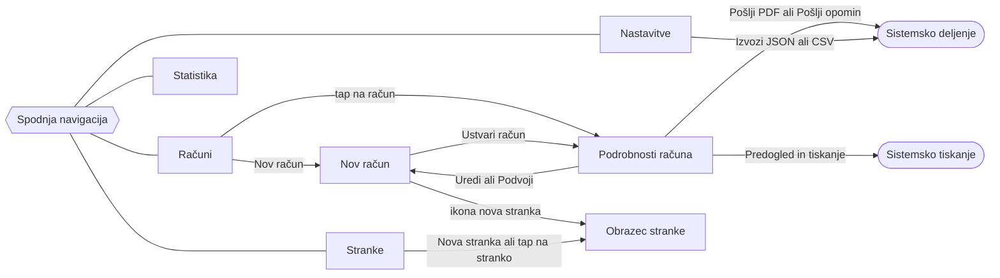

### 4.2 Zasloni

#### Računi

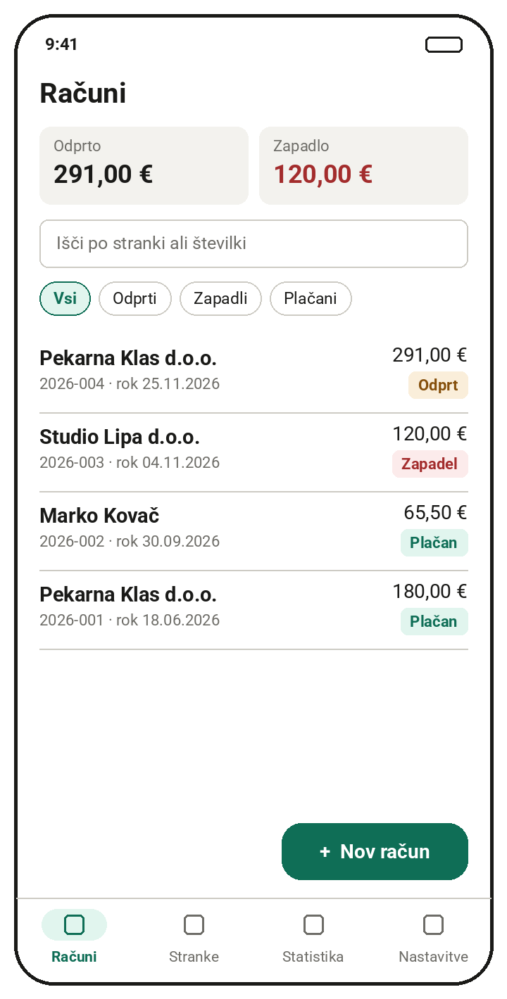

Začetni zaslon. Na vrhu sta seštevka odprtih in zapadlih zneskov, pod njima iskanje in filtri Vsi, Odprti, Zapadli, Plačani. Vsaka vrstica prikazuje stranko, številko, rok, znesek in oznako stanja. Gumb »Nov račun« odpre obrazec. **Pokriva:** US-06, US-07

#### Nov račun in Uredi račun

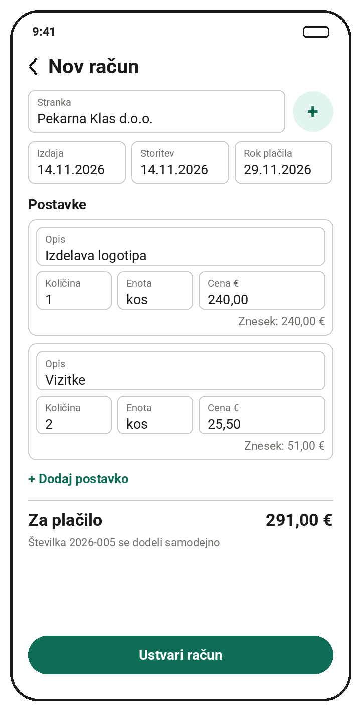

Izbira stranke (ali dodajanje nove z ikono), datum izdaje, datum storitve in rok plačila, poljubno število postavk, neobvezna opomba ter sproten izračun zneska. Isti zaslon se uporablja za urejanje in podvajanje računa. **Pokriva:** US-03, US-09

#### Podrobnosti računa

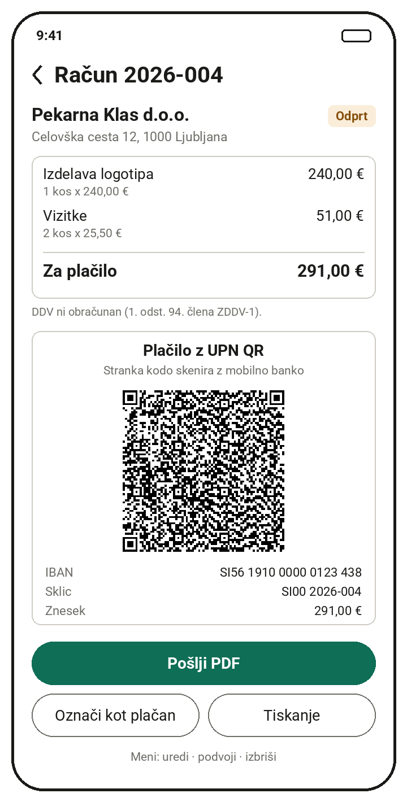

Kupec, datumi, postavke, zneski, klavzula o DDV in koda UPN QR s IBAN-om in sklicem. Gumbi »Pošlji PDF«, »Predogled in tiskanje« in »Označi kot plačan« (oziroma »Označi kot neplačan«); pri zapadlem računu še »Pošlji opomin«. Meni v naslovni vrstici: Uredi, Podvoji, Izbriši. **Pokriva:** US-04, US-05, US-06, US-08, US-09

#### Stranke

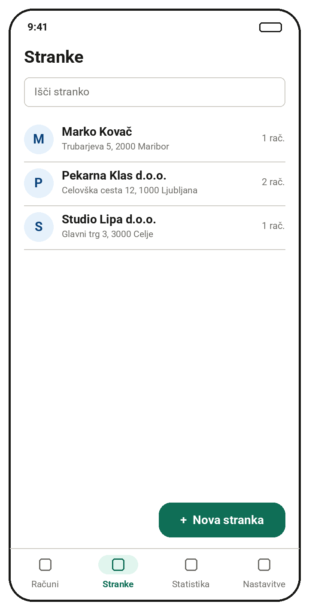

Seznam strank z iskanjem po imenu in številom računov. Gumb »Nova stranka« in tap na stranko odpreta obrazec stranke. **Pokriva:** US-02

#### Obrazec stranke

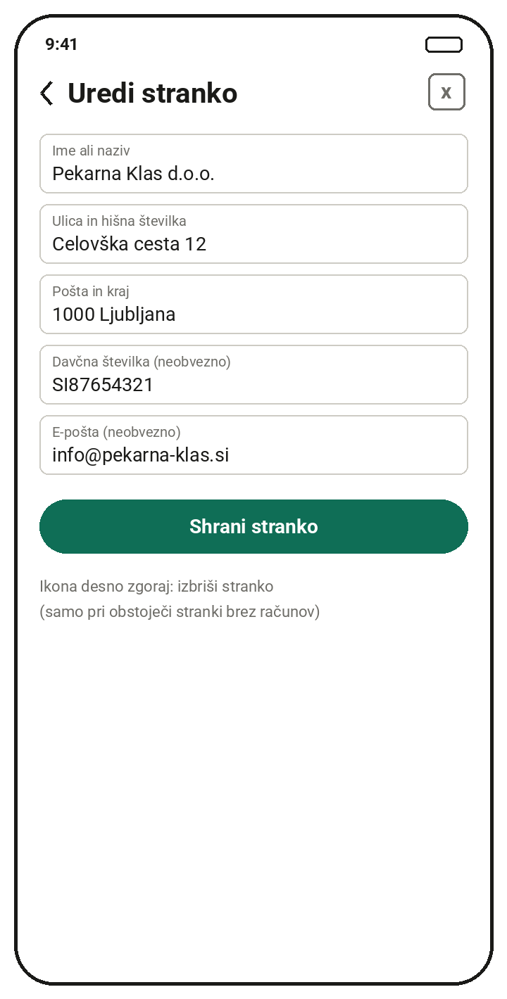

Ime ali naziv, ulica, pošta in kraj so obvezni, davčna številka in e-pošta neobvezni. Pri obstoječi stranki je v naslovni vrstici ikona za brisanje. **Pokriva:** US-02

#### Statistika

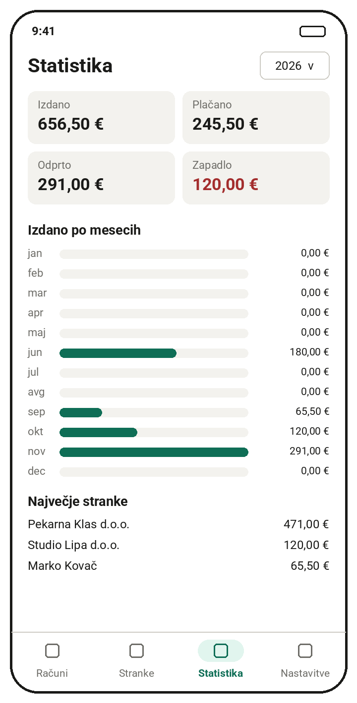

Izbira leta, zneski Izdano, Plačano, Odprto in Zapadlo, izdani zneski po mesecih in do 5 strank z največjim zneskom. **Pokriva:** US-11

#### Nastavitve

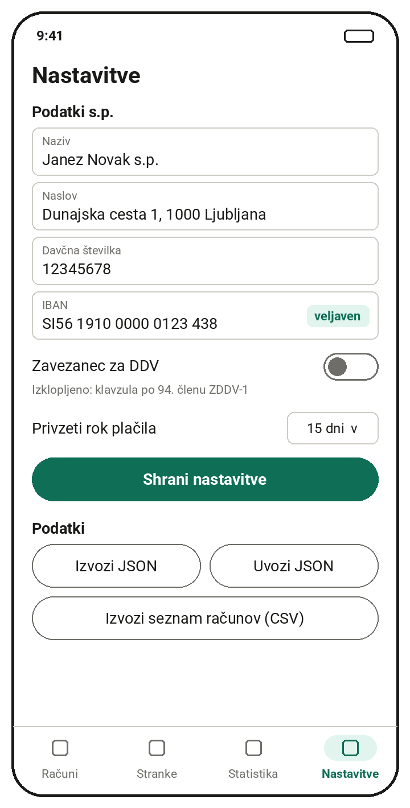

Podatki s.p. s preverjanjem IBAN-a, stikalo »Zavezanec za DDV« s stopnjo, privzeti rok plačila (8, 15, 30 ali 60 dni) ter izvoz in uvoz podatkov. **Pokriva:** US-01, US-10, US-12

---

## 5. Arhitektura

### 5.1 Kontekst (C4, raven 1)

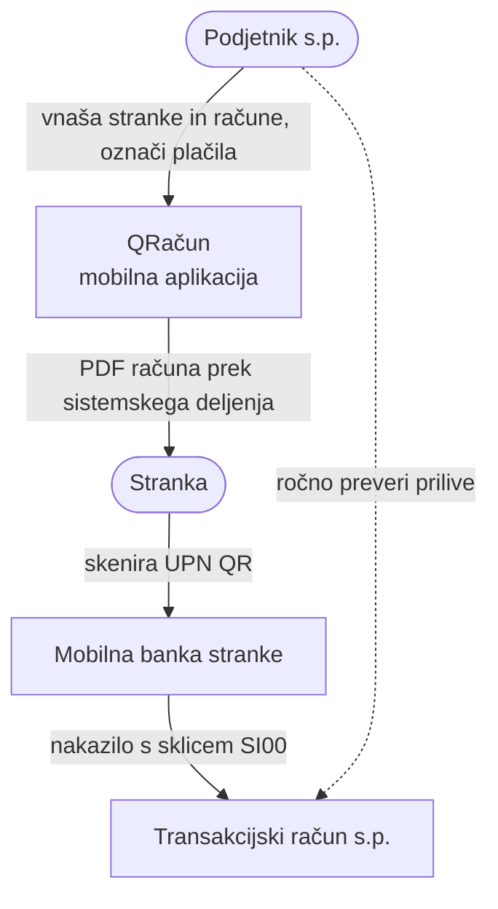

QRačun z mobilno banko in transakcijskim računom ne komunicira. Povezava med njimi je samo vsebina kode UPN QR (glej 7.1).

### 5.2 Vsebniki (C4, raven 2)

Ne velja: aplikacija nima strežnika in ne uporablja zunanjih storitev. Vsi podatki so v lokalni bazi SQLite na napravi, sestava aplikacije je opisana v 5.3.

### 5.3 Plasti aplikacije

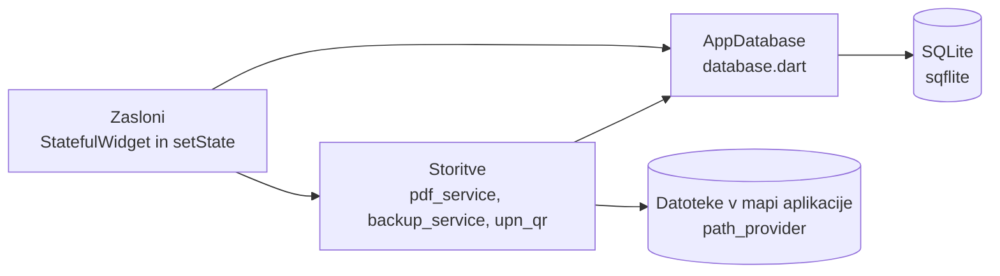

Aplikacija nima ločene plasti ViewModel. Vsak zaslon je `StatefulWidget`, ki ob odprtju prebere podatke iz `AppDatabase` in jih prikaže s `setState`; po vrnitvi s podrejenega zaslona jih prebere znova. `AppDatabase` ima vlogo repozitorija in je edini razred, ki dostopa do SQLite. Storitve vsebujejo logiko brez uporabniškega vmesnika: `upn_qr.dart` sestavi vsebino kode in preveri IBAN, `pdf_service.dart` izdela PDF, `backup_service.dart` izvozi in uvozi podatke. Knjižnice po plasteh: zasloni uporabljajo Flutter Material 3 in `flutter_localizations` (slovenski izbirnik datuma) ter `barcode_widget` za prikaz kode; podatki `sqflite`, `path` in `path_provider`; storitve `pdf`, `printing` (izdelava, predogled, tiskanje in deljenje PDF), `barcode` (koda QR v PDF) in `share_plus` (deljenje besedila in datotek).

---

## 6. Podatkovni model

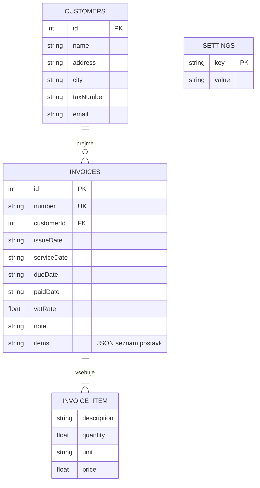

`INVOICE_ITEM` ni ločena tabela: postavke so shranjene kot seznam JSON v stolpcu `items` tabele `invoices`, ker se vedno berejo in pišejo skupaj z računom.

### Stranka (tabela `customers`)

| Atribut | Tip | Obvezen | Opis |
|---|---|---|---|
| id | int | da | Samodejno dodeljen ključ |
| name | string | da | Ime ali naziv stranke |
| address | string | da | Ulica in hišna številka |
| city | string | da | Pošta in kraj, npr. »1000 Ljubljana« |
| taxNumber | string | ne | Davčna številka; prazen niz, če ni vpisana |
| email | string | ne | E-pošta; samo shranjena |

Stranke z računi ni mogoče izbrisati. To preverja aplikacija v `deleteCustomer`, baza tujega ključa ne uveljavlja.

### Račun (tabela `invoices`)

| Atribut | Tip | Obvezen | Opis |
|---|---|---|---|
| id | int | da | Samodejno dodeljen ključ |
| number | string | da | Številka v obliki LLLL-NNN, unikatna (8.4.3) |
| customerId | int | da | Stranka (`customers.id`) |
| issueDate | string | da | Datum izdaje, oblika LLLL-MM-DD |
| serviceDate | string | da | Datum opravljene storitve |
| dueDate | string | da | Rok plačila, ne pred datumom izdaje |
| paidDate | string | ne | Datum plačila; `null` pomeni neplačan |
| vatRate | float | da | Stopnja DDV v %; 0 pomeni brez DDV. Ob izdaji se prepiše iz nastavitev in se kasneje ne spreminja. |
| note | string | ne | Opomba na računu |
| items | string (JSON) | da | Seznam postavk, najmanj ena |

Izračunani podatki, ki se ne shranjujejo: znesek brez DDV, DDV in znesek za plačilo (8.4.2), stanje (8.3) in sklic (`SI00` + številka).

### Postavka (v stolpcu `items`)

| Atribut | Tip | Obvezen | Opis |
|---|---|---|---|
| description | string | da | Opis storitve ali blaga |
| quantity | float | da | Količina, večja od 0 |
| unit | string | ne | Enota, privzeto »kos« |
| price | float | da | Cena na enoto brez DDV v EUR, večja od 0 |

### Podatki s.p. (tabela `settings`)

Shranjeni kot pari ključ in vrednost (oba besedilo):

| Ključ | Obvezen | Opis |
|---|---|---|
| name, address, city, taxNumber | da | Naziv, ulica, pošta in kraj, davčna številka |
| iban | da | IBAN brez presledkov, preverjen po 8.4.4 |
| regNumber, email | ne | Matična številka, e-pošta |
| vatPayer | da | »1« zavezanec za DDV, »0« ni zavezanec |
| vatRate | da | Stopnja DDV v %, privzeto 22 |
| defaultDueDays | da | Privzeti rok plačila v dneh: 8, 15, 30 ali 60 |

**Hramba:** podatki so samo na napravi, v bazi `racuni_sp.db` v mapi baz aplikacije. Strežnika ni, zato ni konfliktov. Varnostna kopija ima to obliko (skrajšano):

```json
{
  "app": "racuni_sp",
  "version": 1,
  "exportedAt": "2026-11-20T10:15:00.000",
  "profile": { "name": "Janez Novak s.p.", "iban": "SI56191000000123438", "vatPayer": "0" },
  "customers": [ { "id": 1, "name": "Pekarna Klas d.o.o.", "address": "Celovška cesta 12", "city": "1000 Ljubljana", "taxNumber": "", "email": "" } ],
  "invoices": [ { "id": 1, "number": "2026-001", "customerId": 1, "issueDate": "2026-11-10", "serviceDate": "2026-11-10", "dueDate": "2026-11-25", "paidDate": null, "vatRate": 0.0, "note": "", "items": [ { "description": "Izdelava logotipa", "quantity": 1.0, "unit": "kos", "price": 240.0 } ] } ]
}
```

Uvoz zamenja vse obstoječe podatke; podatkov iz kopije in naprave ne združuje.

---

## 7. Zunanji vmesniki

Aplikacija ne uporablja zunanjih spletnih API-jev in nima lastnega strežnika. Edini zunanji vmesnik je podatkovni format UPN QR, ki ga bere mobilna banka stranke.

### 7.1 Format UPN QR

| | |
|---|---|
| **Namen** | Prenos podatkov za plačilo iz računa v mobilno banko stranke |
| **Dokumentacija** | Tehnični standard UPN QR, Združenje bank Slovenije (upn-qr.si) |
| **Avtentikacija** | brez |
| **Omejitve** | Koda QR verzije 15, stopnja popravljanja napak M, znaki v kodiranju ISO 8859-2, omejene dolžine polj (8.4.1) |

**Vsebina kode** za račun 2026-004 (vsaka vrstica je eno polje, ločeno z LF; prazne vrstice so prazna polja):

```text
UPNQR


Pekarna Klas d.o.o.
Celovška cesta 12
1000 Ljubljana
00000029100


OTHR
Plačilo računa 2026-004
25.11.2026
SI56191000000123438
SI002026-004
Janez Novak s.p.
Dunajska cesta 1
1000 Ljubljana
199
```

**Napake:** če IBAN v nastavitvah ni veljaven, aplikacija kode ne izdela in na zaslonu izpiše opozorilo (US-04); PDF nastane brez kode. Predolga besedila se skrajšajo, znaki, ki jih ISO 8859-2 ne podpira, se zamenjajo z »?«. Znana omejitev: koda nima oznake ECI za ISO 8859-2, ker je knjižnica `barcode` ne podpira, zato je treba branje imen s šumniki preveriti s pravo mobilno banko.

### API-ji naprave

| API | Dovoljenje | Za kaj |
|---|---|---|
| Sistemsko deljenje (`share_plus`, `Printing.sharePdf`) | ni potrebno | Pošiljanje PDF računa, opomina, varnostne kopije in CSV |
| Sistemsko tiskanje (`Printing.layoutPdf`) | ni potrebno | Predogled in tiskanje računa |
| Zasebna mapa aplikacije (`path_provider`, `sqflite`) | ni potrebno | Baza, varnostne kopije in datoteke CSV |
| Odložišče (`Clipboard`) | ni potrebno; iOS ob branju vpraša »Dovoli lepljenje« | Uvoz varnostne kopije, prilepljene kot besedilo |

---

## 8. Dinamika

### 8.1 Izdaja in pošiljanje računa

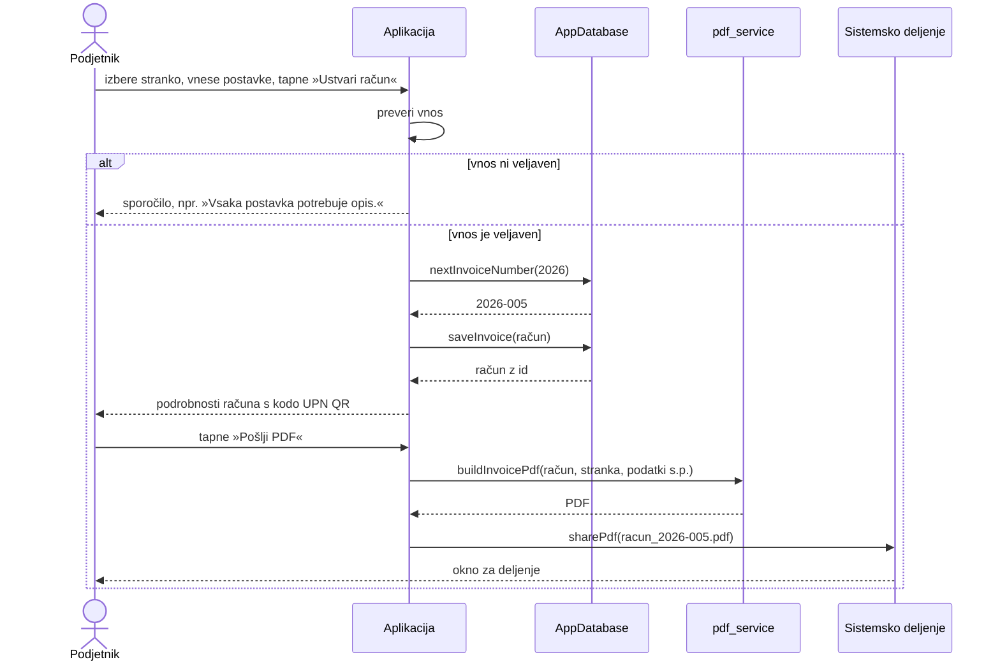

### 8.2 Uvoz varnostne kopije

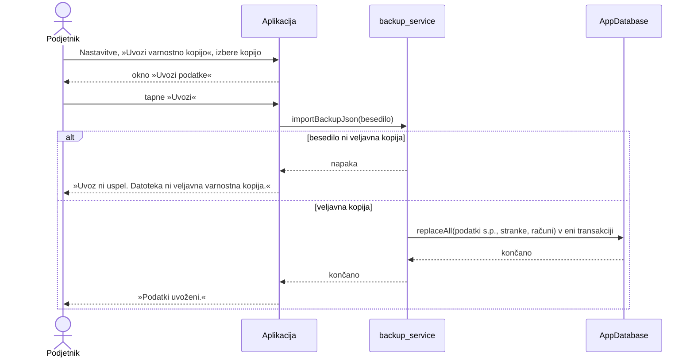

### 8.3 Stanja: račun

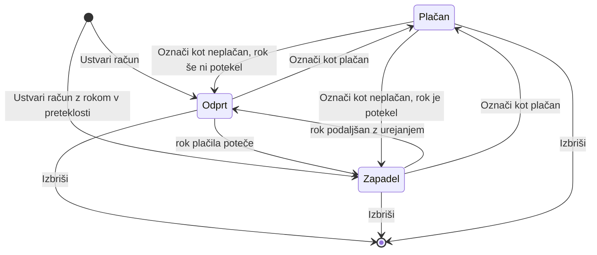

Stanje se ne shranjuje, ampak se izračuna ob vsakem prikazu: če je `paidDate` vpisan, je račun Plačan; sicer je Zapadel, če je `dueDate` pred današnjim dnem; sicer je Odprt. Zato račun preide v Zapadel brez dejanja uporabnika.

### 8.4 Algoritmi

#### 8.4.1 Vsebina UPN QR

- **Vhod:** račun (številka, rok plačila, znesek za plačilo v EUR), stranka (ime, ulica, kraj), podatki s.p. (naziv, ulica, kraj, IBAN).
- **Izhod:** besedilo z 19 polji in kontrolno vsoto, vsako zaključeno z LF; kodirano v ISO 8859-2 in izrisano kot koda QR verzije 15 s stopnjo M.
- **Pravilo:**

  | Polje | Vsebina | Največ znakov |
  |---|---|---|
  | 1 | `UPNQR` | |
  | 2–5 | prazno | |
  | 6–8 | ime, ulica in kraj plačnika (stranke) | 33 |
  | 9 | znesek v centih, dopolnjen z ničlami na 11 mest | 11 |
  | 10–11 | prazno | |
  | 12 | koda namena `OTHR` | 4 |
  | 13 | namen »Plačilo računa ‹številka›« | 42 |
  | 14 | rok plačila DD.MM.LLLL | 10 |
  | 15 | IBAN prejemnika brez presledkov | 19 |
  | 16 | sklic `SI00` + številka računa | 26 |
  | 17–19 | naziv, ulica in kraj prejemnika (s.p.) | 33 |
  | 20 | kontrolna vsota = 19 + vsota dolžin polj 1–19, na 3 mesta | 3 |

- **Robni primeri:** predolgo besedilo se skrajša na največjo dolžino; nove vrstice v besedilu se izpustijo; znaki zunaj ISO 8859-2 se zamenjajo z »?«; pri neveljavnem IBAN-u se koda ne izdela.
- **Primer:** račun 2026-004 za 291,00 € (razdelek 7.1). Znesek 291,00 € je 29100 centov, zapisano `00000029100`. Dolžine polj so skupaj 180, kontrolna vsota je 180 + 19 = `199`.

#### 8.4.2 Zneski računa

- **Vhod:** postavke (količina, cena na enoto v EUR) in stopnja DDV v %.
- **Izhod:** znesek brez DDV, DDV in znesek za plačilo v EUR na 2 decimalki.
- **Pravilo:** znesek postavke = zaokroži(količina × cena); brez DDV = zaokroži(vsota zneskov postavk); DDV = zaokroži(brez DDV × stopnja / 100); za plačilo = zaokroži(brez DDV + DDV). Zaokroževanje je na 2 decimalki.
- **Robni primeri:** decimalna količina (1,5 ure) je dovoljena; količina ali cena 0 ali manj je zavrnjena (US-03); stopnja 0 pomeni, da se vrstica DDV ne izpiše.
- **Primer:** 1 × 200,00 + 2 × 25,50 = 251,00 €; pri 22 % je DDV 55,22 € in za plačilo 306,22 €.

#### 8.4.3 Številka računa

- **Vhod:** leto iz datuma izdaje, obstoječe številke računov.
- **Izhod:** številka v obliki LLLL-NNN.
- **Pravilo:** poišči največjo številko, ki se začne z »LLLL-«, in ji prištej 1; če je v tem letu ni, je številka LLLL-001. Pri urejanju se številka ne spremeni.
- **Robni primeri:** prvi račun v novem letu dobi 001; če uporabnik izbriše zadnji račun v letu, naslednji račun ponovno dobi njegovo številko; aplikacija podpira največ 999 računov na leto.
- **Primer:** obstajata 2026-003 in 2026-004, nov račun z datumom izdaje 20.11.2026 dobi 2026-005, račun z datumom 5.1.2027 pa 2027-001.

#### 8.4.4 Preverjanje IBAN

- **Vhod:** IBAN, kot ga vpiše uporabnik (lahko s presledki in malimi črkami).
- **Izhod:** veljaven ali neveljaven.
- **Pravilo:** odstrani presledke in pretvori v velike črke; IBAN mora imeti obliko `SI56` in 15 števk; prve 4 znake prestavi na konec, črke zamenjaj s števili (A = 10 … Z = 35); ostanek pri deljenju s 97 mora biti 1.
- **Robni primeri:** IBAN druge države (npr. HR) je zavrnjen; 18 ali 20 znakov je zavrnjeno.
- **Primer:** `SI56 1910 0000 0123 438` je veljaven; `SI56 0123 4567 8901 234` je neveljaven, ker ostanek ni 1.

---

## 9. Sledljivost

| Zgodba | Prioriteta | Zasloni | Preverjanje | Stanje |
|---|---|---|---|---|
| US-01 | Must | Nastavitve | ročni test po scenarijih, enotski test IBAN | v delu |
| US-02 | Must | Stranke, Obrazec stranke | ročni test po scenarijih | v delu |
| US-03 | Must | Nov račun, Podrobnosti računa | ročni test po scenarijih, enotski test zneskov | v delu |
| US-04 | Must | Podrobnosti računa | enotski testi UPN QR, skeniranje z mobilno banko | v delu |
| US-05 | Must | Podrobnosti računa | ročni test po scenarijih | v delu |
| US-06 | Must | Računi, Podrobnosti računa | ročni test po scenarijih, enotski test stanj | v delu |
| US-07 | Should | Računi | ročni test po scenarijih | v delu |
| US-08 | Should | Podrobnosti računa | ročni test po scenarijih | v delu |
| US-09 | Should | Podrobnosti računa, Nov račun | ročni test po scenarijih | v delu |
| US-10 | Should | Nastavitve | ročni test po scenarijih | v delu |
| US-11 | Could | Statistika | ročni test po scenarijih | v delu |
| US-12 | Could | Nastavitve | ročni test, odpiranje v Excelu | v delu |

---

## 10. Zgodovina sprememb

| Različica | Datum | Spremembe |
|---|---|---|
| 0.1 | 20. 11. 2026 | Prva različica |
